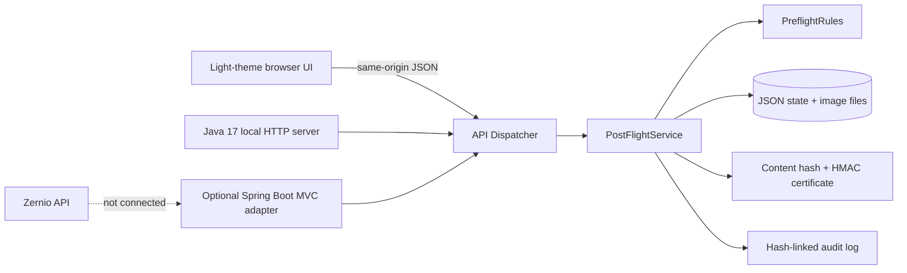

# Architecture — PostFlight Enterprise local build

## Boundaries

- **Presentation:** `web/index.html`, `web/assets/styles.css`, `web/assets/app.js`. SPA-style navigation over 12 modules. Legacy all-in-one JavaScript frontend was separated from HTML/CSS for this build, but a React migration remains future work.
- **Application/domain:** `backend/.../core/PostFlightService.java` manages synchronous state transitions with defensive validation and synchronized file mutations.
- **Policy:** `PreflightRules.java` implements fixed financial/content rules. Custom exact-substring rules are versioned with policy revisions and added to future validation runs.
- **Persistence:** atomic JSON-file replacement and PNG/JPEG assets on the local filesystem. This is fit for a developer preview, **not** scale-out, multi-node availability or disaster recovery.
- **Entry points:** `local/LocalServer.java` (dependency-free) and `spring/PostFlightApiController.java` (framework adapter using the same dispatcher).

## Release invariants

1. Draft edits change version/hash and reset review decision.
2. A validation result is tied to draft content hash, draft version, policy version and platform.
3. A release is not issued if its validation is absent/stale, the verdict is `BLOCKED`, or review is not `Approved`.
4. Issued evidence records contain a local HMAC seal; verification checks the exact historical evidence tuple.
5. Audit records include `previousHash` and `hash` for ordering detection. A disk administrator can still modify the key and state; this is **tamper-evident, not tamper-proof**.
6. Changing a custom rule increments the active policy version, invalidating eligibility from previous policy versions until revalidation.
7. The publishing integration is intentionally absent. A release certificate is an *internal handoff artifact*, not a social post.

## Production architecture (not built)

Separate tenant-scoped PostgreSQL entities (Draft, DraftVersion, ValidationRun, Finding, RuleSet, ReviewDecision, Release, AuditEvent), fine-grained RBAC, durable job coordination/outbox, S3 media with signed URLs and malware checks, strict provider clients, webhook signature verification, observability, secrets-management, external evidence retention, CI/CD and load testing. Deploy separate services only when proven necessary; a modular Spring Boot application can be the first secure production baseline.
